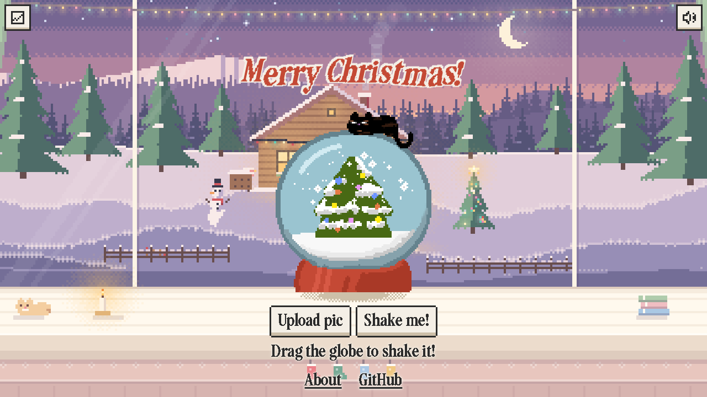
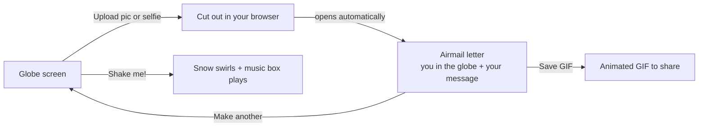
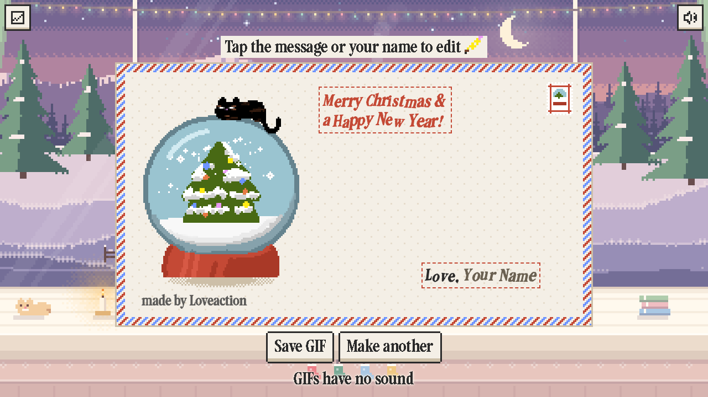

# Create a Christmas Letter 🎄

A cozy retro Christmas letter for yourself and friends. A Christmas gift from me to you <3

Pop a cheeky photo of yourself, your pet, or a loved one into a pixel-art snowglobe, give it a shake, and save it as an animated GIF to share as a Christmas letter with your friends and family.

**Live:** https://christmas-letter-lemon.vercel.app



## How it works



1. **Globe screen.** Pick a cosy window scene, add a photo, and shake the globe by dragging it, tapping **Shake me!**, pressing Space, or shaking your phone. Snow swirls and settles while a music-box carol winds down with it.
2. **Letter screen.** As soon as your photo is cut out, an envelope opens onto a pixel airmail letter: a small live copy of the globe, a handwritten "Merry Christmas & a Happy New Year!" and "Love, [name]". Tap the message or your name to edit them, then save the letter as a looping GIF (shared from the preview dialog on phones, downloaded on desktop). **Make another** starts over.

Your photo is a smooth, true-colour cut-out (not pixelated) standing in front of the tree.



An example GIF (no photo): [docs/example.gif](docs/example.gif)

## Status

All phases in `SPEC.md` are done.

| Phase | What | Status |
| --- | --- | --- |
| 0 | Asset pass: sprites, backgrounds, palette, generated pixel art | ✅ Done |
| 1 | Responsive globe screen, background picker, About | ✅ Done |
| 2 | Snow and shaking (drag, button, keyboard, device motion) | ✅ Done |
| 3 | Music box (public-domain carols) | ✅ Done |
| 4 | Photo upload, in-browser background removal | ✅ Done |
| 5 | Letter screen with editable message | ✅ Done |
| 6 | Save GIF and share | ✅ Done |
| 7 | Polish, accessibility and performance pass | ✅ Done |

## Privacy

> **Your photos stay on your device.**
> This app runs entirely in your browser. Your photo is never uploaded, stored, or sent to me, to any AI service, or to any third party.
> This uses @imgly/background-removal, which is an in-browser background removal, meaning that your images remain secure within your own devices: refreshing or closing the page clears it.
> The web app only remembers your sound and background choices and what you write, in your own browser.
> GIFs you save go only where you choose to share them.

The site only loads its own static files. There's no backend, no accounts and no analytics, and the background-removal model is self-hosted rather than loaded from a CDN.

## Tech stack

| Concern | Choice |
| --- | --- |
| Build | [Vite](https://vite.dev) + TypeScript, no framework |
| Rendering | Canvas 2D at native art resolution, scaled by whole numbers with `image-rendering: pixelated` |
| Background removal | `@imgly/background-removal`, self-hosted, lazy-loaded and run in the browser |
| Audio | Web Audio API, synthesised music-box tones |
| GIF export | `gifenc`, lazy-loaded when you press Save GIF |
| Font | Pixelta and Pixelta Rounded by Blankids, falling back to Pixelify Sans |
| Tests | Vitest (layout, text and GIF logic) and Playwright (viewports, letter, GIF export, photo privacy) |
| Hosting | Vercel, deployed as a prebuilt build from a local machine |

### Pixel-perfect scaling

All art is drawn at its real pixel size: the globe is a 96×120 frame, and the backgrounds are 384×216 (desktop), 384×240 (laptop) and 216×384 (mobile). The layout picks the background that best fits the screen's shape and scales it to cover the screen by a whole number of **device** pixels. The globe uses the same scale where it fits, so its pixels match the scene's, and it stands on the windowsill. Every art pixel stays a crisp square on any phone, tablet or monitor.

## Running it locally

Needs Node 22 or newer. Vercel builds use Node 24.

```bash
npm install
npm run dev          # http://localhost:5173
npm test             # unit tests
npm run test:e2e     # Playwright viewport tests (first run: npx playwright install chromium)
npm run lint         # TypeScript + Prettier
```

### Fonts

Pixelta is a licensed font, so its files are **not** in this repo. Without them the app falls back to [Pixelify Sans](https://fonts.google.com/specimen/Pixelify+Sans) (SIL Open Font License) and still works.

If you hold a Pixelta licence:

1. Put `Pixelta-Regular.ttf` and `Pixelta-Rounded.ttf` in `fonts-local/` (git-ignored).
2. Run `npm run font` to write the `.woff2` files to `public/fonts/` (also git-ignored).

### Assets

Source art lives in `design/source/`. The scripts that rebuild `public/assets/` are:

```bash
npm run assets   # crop and alpha-clean the owner sprites, downscale backgrounds, draw generated pixel art
```

`design/preview.html` shows every asset at 4×. Open it through the dev server at http://localhost:5173/design/preview.html.

## Deploying

The fonts can't go into git, so the site is built locally and the finished output is uploaded to Vercel:

```bash
npm run deploy        # checks + tests, then a preview deployment
npm run deploy:prod   # checks + tests, then production
```

The Vercel project is deliberately **not** connected to GitHub. Builds on Vercel's servers wouldn't have the fonts.

## Project structure

```
design/        source art, the layout sketch and the asset preview page
public/assets/ processed pixel art served by the app
scripts/       asset pipeline (normalise, draw, fonts)
src/
  assets/manifest.ts   every asset's size and anchor point
  palette.ts           shared colour palette
  render/              integer scaling, globe and letter drawing, text fitting, GIF export
  screens/             globe screen and letter screen
  photo/               upload menu, selfie, cut-out
  audio/               music box
  ui/                  handwritten greeting effect
  state.ts             saved preferences (never photos)
docs/          README screenshots and an example GIF
tests/         Vitest unit tests and Playwright e2e tests
```

## Credits

Made by Loveaction Alyssa. Font: Pixelta by Blankids. Carols are in the public domain. Background removal by IMG.LY.

If you use and enjoy this, feel free to tag me on my socials!

## Licences

The app's own code is released under the [MIT License](LICENSE). `@imgly/background-removal` is AGPL-3.0, so the deployed app as a whole also has to meet the AGPL (in practice: keep this source public); MIT is compatible with that. Dependencies: `gifenc` is MIT, Pixelify Sans is SIL OFL, and Vite, Vitest and Playwright are MIT or Apache-2.0. The Pixelta fonts are licensed separately and aren't covered by this repo.
